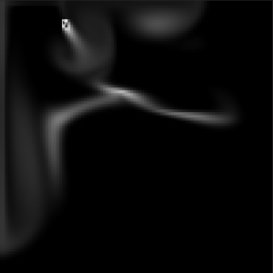
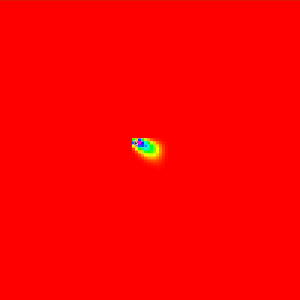
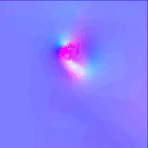
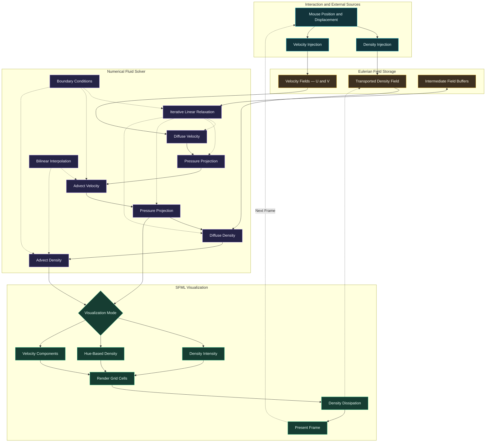

<div align="center">

  <h1>Navier–Stokes Fluid Simulation</h1>

  <p>
    <strong>Visualizing the mathematics of fluid motion.</strong>
  </p>

  <p>
    An interactive Eulerian fluid simulation exploring the
    Navier–Stokes equations, numerical methods, velocity fields,
    and computational fluid dynamics through C++ and SFML.
  </p>

  [](https://isocpp.org/)
  [](https://www.sfml-dev.org/)
  [](#mathematical-foundation)
  [](#numerical-methods)
  [](./LICENSE)

  <p>
    <a href="#overview">Overview</a> ·
    <a href="#visualization">Visualization</a> ·
    <a href="#mathematical-foundation">Mathematics</a> ·
    <a href="#simulation-pipeline">Pipeline</a> ·
    <a href="#getting-started">Getting Started</a>
  </p>

  

  <sub>
    Computational fluid dynamics · Eulerian simulation · Interactive visualization
  </sub>

</div>

## Overview

Navier–Stokes Fluid Simulation is a native desktop application
exploring the numerical approximation of fluid motion within
a two-dimensional spatial domain.

The simulation represents a fluid through velocity and density
fields defined over a fixed computational grid. These fields
evolve through successive diffusion, advection, and pressure
projection operations.

An Eulerian formulation allows fluid properties to be evaluated
at fixed spatial locations while the simulated material moves
through the domain.

Built with C++ and SFML, the project connects mathematical
modeling with numerical computation, interactive graphics,
and real-time visualization.

Its principal areas of exploration include:

- Computational fluid dynamics.
- Incompressible flow approximation.
- Numerical discretization.
- Iterative linear solvers.
- Vector and scalar field visualization.
- Interactive computer graphics.

## Visualization

The simulation provides three visualization modes that expose
different aspects of the underlying numerical fields.

### Density Field

The default visualization represents the transported density
field through grayscale intensity.

Brighter regions correspond to higher dye concentration,
making diffusion, transport, and fluid mixing directly visible.

### Color and Velocity Fields

<table>
  <tr>
    <td align="center" width="50%">
      <strong>HSB Visualization</strong>
    </td>
    <td align="center" width="50%">
      <strong>Velocity Visualization</strong>
    </td>
  </tr>
  <tr>
    <td>
      
    </td>
    <td>
      
    </td>
  </tr>
  <tr>
    <td align="center">
      <sub>Density mapped to a continuous hue spectrum.</sub>
    </td>
    <td align="center">
      <sub>Directional velocity encoded through RGB channels.</sub>
    </td>
  </tr>
</table>

Each visualization exposes a different interpretation of
the same computational environment.

| Mode | Representation |
| :--- | :--- |
| **Default** | White intensity proportional to dye density. |
| **HSB** | Density mapped to hue with constant saturation and brightness. |
| **Velocity** | Horizontal and vertical velocity components mapped to red and green channels. |

Switching visualization modes does not modify the underlying
physical simulation.

## Features

| Feature | Description |
| :--- | :--- |
| **Eulerian Fluid Simulation** | Numerical computation over a fixed two-dimensional grid. |
| **Navier–Stokes Approximation** | Fluid motion modeled through diffusion, transport, and pressure correction. |
| **Semi-Lagrangian Advection** | Backward trajectory sampling with bilinear interpolation. |
| **Iterative Solver** | Gauss–Seidel-style relaxation for diffusion and pressure approximation. |
| **Boundary Conditions** | Direction-dependent treatment of velocity and scalar fields at domain boundaries. |
| **Interactive Density Injection** | Introduce dye into the fluid using mouse input. |
| **Interactive Velocity Injection** | Modify fluid motion through cursor displacement. |
| **Multiple Visualization Modes** | Density, HSB, and velocity field representations. |
| **Density Dissipation** | Progressive fading of the transported visual scalar. |
| **Native Desktop Rendering** | Interactive graphical output through SFML. |
| **Modular C++ Architecture** | Separation of numerical operations, field storage, rendering, and application state. |

## Mathematical Foundation

The simulation is based on the numerical approximation
of the incompressible Navier–Stokes equations.

These equations describe how a fluid velocity field evolves
under the influence of pressure, viscosity, and external forces.

### Navier–Stokes equations

The momentum equation for incompressible fluid flow is:

$$
\frac{\partial\mathbf{u}}{\partial t}
+
(\mathbf{u}\cdot\nabla)\mathbf{u}
=
-\frac{1}{\rho}\nabla p
+
\nu\nabla^2\mathbf{u}
+
\mathbf{f}
$$

Subject to the incompressibility condition:

$$
\nabla\cdot\mathbf{u}=0
$$

Where:

| Symbol | Description |
| :---: | :--- |
| $\mathbf{u}$ | Fluid velocity field. |
| $p$ | Pressure. |
| $\rho$ | Physical fluid density. |
| $\nu$ | Kinematic viscosity. |
| $\mathbf{f}$ | External acceleration or forcing. |
| $\nabla$ | Spatial differential operator. |

The simulation decomposes these continuous equations into
discrete numerical operations that can be evaluated over
a finite computational domain.

### Eulerian representation

An Eulerian simulation represents physical quantities
at fixed spatial positions.

For a two-dimensional domain, the velocity field is:

$$
\mathbf{u}(x,y,t)=
\begin{bmatrix}
u(x,y,t)\\
v(x,y,t)
\end{bmatrix}
$$

The simulation also maintains a transported scalar field:

$$
d=d(x,y,t)
$$

This scalar represents visual dye concentration rather than
the physical mass density appearing in the momentum equation.

Unlike particle-based simulation methods, the grid remains
stationary throughout the computation.

### Spatial discretization

The continuous domain is approximated using a regular grid.

| Property | Configuration |
| :--- | :--- |
| Spatial dimensions | 2 |
| Grid resolution | 70 × 70 |
| Allocated grid cells | 4,900 |
| Interior cells | 68 × 68 |
| Graphical cell size | 8 × 8 pixels |
| Window resolution | 560 × 560 pixels |
| Field precision | 32-bit floating point |
| Solver iterations | 16 per iterative operation |
| Execution model | CPU |

Grid positions are mapped into contiguous one-dimensional
arrays using row-major indexing:

$$
I(x,y)=yN+x
$$

Where $N$ represents the grid width.

The indexing implementation also clamps coordinates to
the boundaries of the computational domain.

## Numerical Methods

The solver follows a Stable Fluids-style decomposition,
separating fluid motion into diffusion, advection,
pressure projection, and boundary processing.

### Diffusion

Diffusion describes the spreading of a scalar quantity
or the smoothing of velocity variations throughout
the simulation domain.

Its continuous formulation is:

$$
\frac{\partial q}{\partial t}
=
\kappa\nabla^2q
$$

Where $q$ represents the transported quantity and $\kappa$
represents its diffusion coefficient.

The numerical implementation approximates diffusion
through an iterative linear relaxation process.

Velocity diffusion uses the viscosity parameter,
while density diffusion uses a separate coefficient.

### Semi-Lagrangian Advection

Advection transports physical quantities through
the current velocity field.

The semi-Lagrangian method estimates the origin of
a quantity by tracing backward from its destination:

$$
\mathbf{x}_{previous}
=
\mathbf{x}
-
\Delta t\,\mathbf{u}(\mathbf{x})
$$

The updated field is obtained by sampling the
previous field at the reconstructed position:

$$
q^{new}(\mathbf{x})
=
q^{old}(\mathbf{x}_{previous})
$$

Because the reconstructed position generally falls
between discrete grid cells, the simulation uses
bilinear interpolation.

For four neighboring values, the interpolated quantity is:

$$
q(x,y)=
(1-s)(1-t)q_{00}
+
s(1-t)q_{10}
+
(1-s)tq_{01}
+
stq_{11}
$$

Where $s$ and $t$ represent fractional positions
along the horizontal and vertical axes.

This operation is applied to both velocity components
and the transported density field.

### Pressure Projection

Pressure projection attempts to correct the velocity
field toward divergence-free motion.

The operation consists of three principal stages:

1. Estimate the divergence of the intermediate velocity field.
2. Iteratively approximate the pressure correction field.
3. Subtract the pressure gradient from the velocity.

In normalized mathematical form:

$$
\nabla^2p=\nabla\cdot\mathbf{u}^{*}
$$

$$
\mathbf{u}^{new}
=
\mathbf{u}^{*}
-
\nabla p
$$

The resulting velocity field approaches the
incompressibility condition, subject to the accuracy
of the discretization and iterative solver.

### Boundary Conditions

The simulation operates within a bounded rectangular
domain.

Boundary processing reflects the velocity component
normal to a wall while copying the tangential component
and scalar field values from neighboring interior cells.

This treatment approximates an impermeable boundary,
limiting fluid motion across the domain edges.

Boundary conditions are reapplied throughout the
iterative solving process.

## Simulation Pipeline

The application separates interactive input, numerical
field computation, and graphical rendering.

Each application frame advances the numerical simulation
through a sequence of dependent operations.



The solver performs pressure projection twice during
each fluid update: after velocity diffusion and after
velocity advection.

The corrected velocity field is subsequently used
to transport the density field.

## Technology Stack

<div align="center">

  

</div>

| Technology | Responsibility |
| :--- | :--- |
| **C++17** | Numerical algorithms and native application architecture. |
| **SFML** | Two-dimensional rendering, input processing, and window management. |
| **C++ Standard Library** | Mathematical operations and application utilities. |
| **GCC / G++** | Native application compilation. |
| **GNU Make** | Compilation and execution workflow. |

The project uses a lightweight native implementation
without requiring a dedicated physics engine or
GPU computing framework.

## Getting Started

### Requirements

- A C++17-compatible compiler.
- SFML 2.x development libraries.
- GNU Make.
- A graphical desktop environment.
- Git.

The current source code uses the SFML 2.x API.

Compatibility with SFML 3 requires additional
source code migration.

### Clone the repository

```bash
git clone https://github.com/4beru/navier-stokes-fluid-simulation.git

cd navier-stokes-fluid-simulation
```

### Install dependencies

#### Debian / Ubuntu

```bash
sudo apt install build-essential libsfml-dev
```

#### Arch Linux

Install a C++ compiler and build tools:

```bash
sudo pacman -S --needed base-devel
```

A compatible SFML 2.x installation is also required.
Use an appropriate compatibility package or build
SFML 2.x from source if your distribution provides
a newer major version.

### Build and run

The repository includes a GNU Make build configuration.

```bash
make build
```

The build target performs the following operations:

1. Compile the C++ source files using the C++17 standard.
2. Store the generated object files in `obj/`.
3. Link the application against SFML.
4. Generate the `main` executable.
5. Launch the simulation automatically.

To run an existing build without recompiling:

```bash
./main
```

### Manual compilation

The application can also be compiled directly:

```bash
g++ -std=c++17 -O2 src/*.cpp \
    -o main \
    -lsfml-graphics \
    -lsfml-window \
    -lsfml-system
```

Launch the generated executable:

```bash
./main
```

---

<div align="center">

  <h3>In every flow, a hidden equation.</h3>

  <p>
    Part of <strong>Computational Simulation</strong> — a collection
    of projects exploring numerical methods, mathematical modeling,
    physical phenomena, and the computational representation
    of dynamic systems.
  </p>

  <p>
    <sub>Curated by Abel Ortega.</sub>
  </p>

  <a href="https://github.com/4beru">GitHub</a> ·
  <a href="https://www.aberu.site">Portfolio</a>

</div>
